<a href="https://shelfom.github.io/free-english-learning-tools/">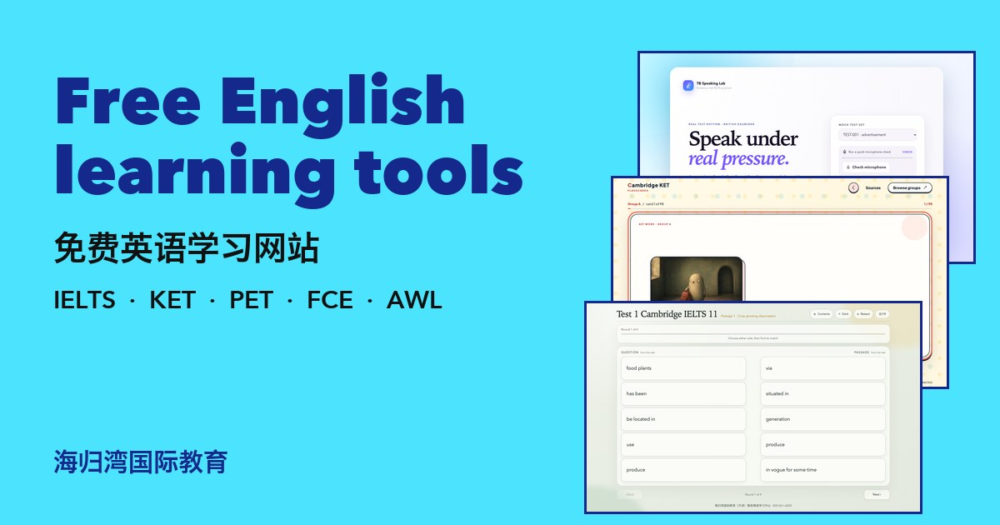</a>

# Free English Learning Tools · 免费英语学习网站

**11 free websites for IELTS, Cambridge KET, PET and FCE, and academic vocabulary.** No sign-up, nothing to install, works on phones, and every line of code is open source.

**11 个免费英语学习网站：雅思听说读写、剑桥 KET / PET / FCE 词卡、学术词汇表。无需注册，手机即开即用，全部开源。**

### 👉 Browse them all on one page: **https://shelfom.github.io/free-english-learning-tools/**

Every site has two doors: **Open** goes to the main site on Coze (fastest in mainland China); **Global mirror** is the same site on GitHub Pages (fast everywhere else).

## IELTS · 雅思

Listening, reading, writing and speaking practice built around real exam skills.

<table>
<tr>
<td width="50%" valign="top"><a href="https://ielts-listening-para.coze.site/">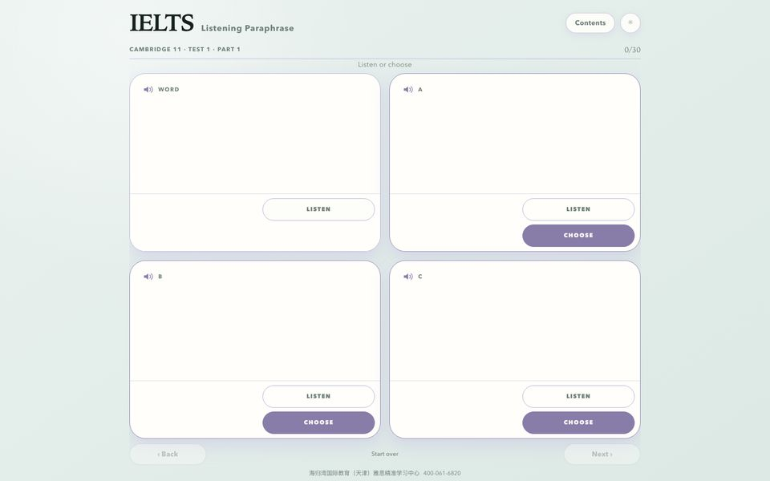</a>

**IELTS Listening Paraphrase** · 雅思听力同义替换 Hear the words IELTS actually tests, then catch their paraphrases by ear. 听真题里的考点词，再从四个读音选项里听出它的同义替换。

[**Open**](https://ielts-listening-para.coze.site/) · [Global mirror](https://shelfom.github.io/ielts-listening-paraphrase/) · [Source](https://github.com/shelfom/ielts-listening-paraphrase)
</td>
<td width="50%" valign="top"><a href="https://ielts-reading-para.coze.site/">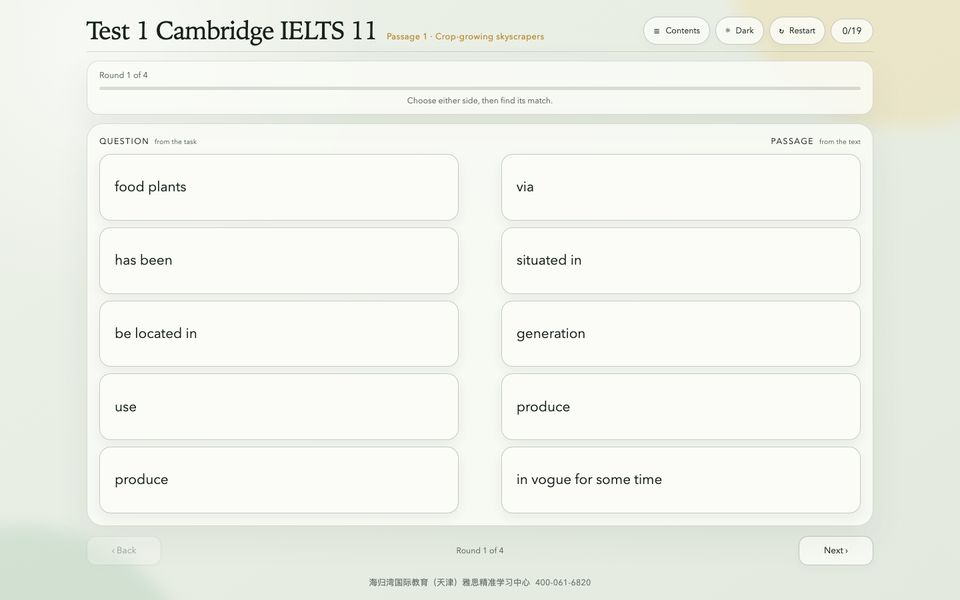</a>

**IELTS Reading Paraphrase** · 雅思阅读同义替换 Match the words in the question to the words in the passage — the core IELTS Reading skill. 把题目里的说法和原文里的说法配对，练的正是雅思阅读最核心的能力。

[**Open**](https://ielts-reading-para.coze.site/) · [Global mirror](https://shelfom.github.io/ielts-reading-paraphrase/) · [Source](https://github.com/shelfom/ielts-reading-paraphrase)
</td>
</tr>
<tr>
<td width="50%" valign="top"><a href="https://ielts-repair.coze.site/">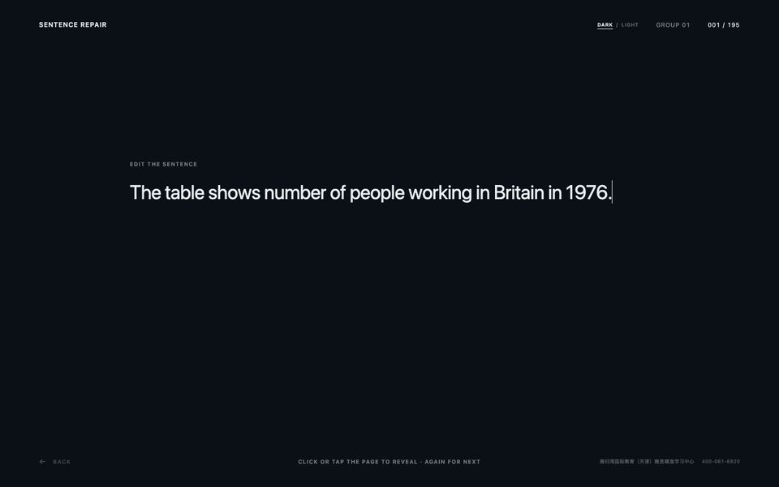</a>

**IELTS Sentence Repair** · 雅思句子改错 Fix the grammar and word mistakes that cost IELTS writers their band score. 改掉那些让雅思作文丢分的语法和用词错误。

[**Open**](https://ielts-repair.coze.site/) · [Global mirror](https://shelfom.github.io/ielts-sentence-repair/) · [Source](https://github.com/shelfom/ielts-sentence-repair)
</td>
<td width="50%" valign="top"><a href="https://ielts-writeback.coze.site/">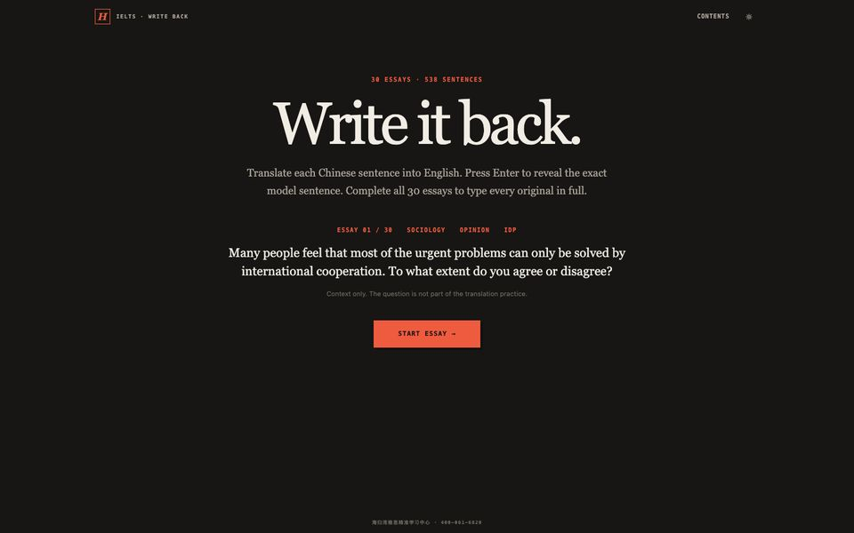</a>

**IELTS Writing Translation · Write It Back** · 雅思写作回译 Translate model essays back from Chinese into English, sentence by sentence, and compare. 把范文的中文一句句译回英文，再对照原句，学会地道的写作表达。

[**Open**](https://ielts-writeback.coze.site/) · [Global mirror](https://shelfom.github.io/ielts-writing-translation/) · [Source](https://github.com/shelfom/ielts-writing-translation)
</td>
</tr>
<tr>
<td width="50%" valign="top"><a href="https://ielts6-8.coze.site/">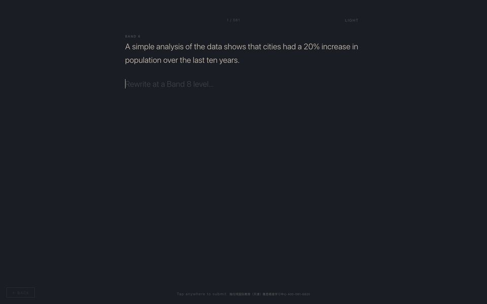</a>

**IELTS Writing · Band 6 to Band 8** · 雅思写作 6 分升 8 分 Rewrite a Band 6 sentence at Band 8, then compare it with a Band 8 version. 把 6 分句子改写成 8 分，再和高分版本对照。

[**Open**](https://ielts6-8.coze.site/) · [Global mirror](https://shelfom.github.io/ielts-writing-band-6-to-8/) · [Source](https://github.com/shelfom/ielts-writing-band-6-to-8)
</td>
<td width="50%" valign="top"><a href="https://ielts-speaking-mock.coze.site/">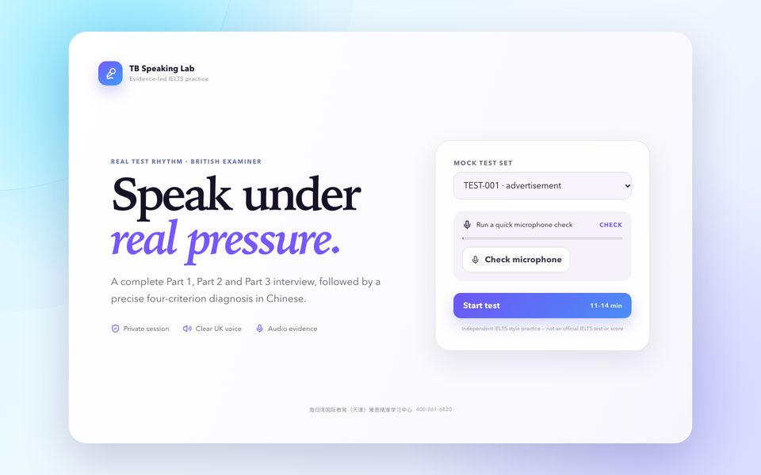</a>

**IELTS Speaking Mock Test** · 雅思口语模考 A full Part 1–3 speaking test with a British AI examiner and a four-criterion band report. 英国口音 AI 考官，完整 Part 1–3 模考，四项评分加中文诊断。

[**Open**](https://ielts-speaking-mock.coze.site/) · [Source](https://github.com/shelfom/ielts-speaking-mock)
</td>
</tr>
<tr>
<td width="50%" valign="top">

**IELTS Writing West** · 雅思写作西游记 Four AI coaches from *Journey to the West* diagnose your essay and guide your rewrite, one criterion at a time. 唐僧、孙悟空、猪八戒、沙僧四位 AI 教练，逐项诊断、指导重写，过四关让作文脱胎换骨。

[**Open**](https://ielts-writing-west.coze.site/) · [Source](https://github.com/shelfom/ielts-writing-west)
</td>
<td width="50%"></td>
</tr>
</table>

## How they work · 图解

Why each IELTS drill exists and how to use it, five cards per site (in Chinese).

**[IELTS Listening Paraphrase · 雅思听力同义替换](https://ielts-listening-para.coze.site/)**

<a href="assets/cards/ielts-listening-paraphrase/01.jpg">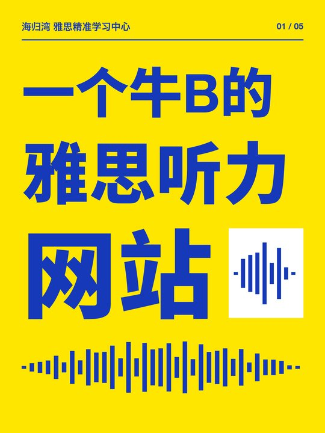</a> <a href="assets/cards/ielts-listening-paraphrase/02.jpg">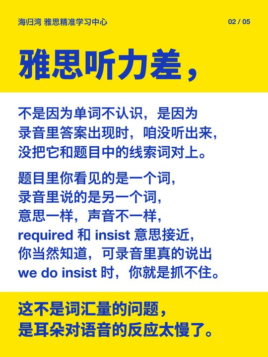</a>  <a href="assets/cards/ielts-listening-paraphrase/04.jpg">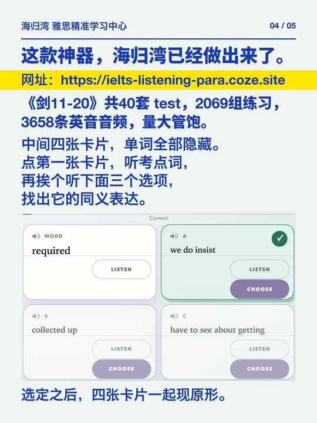</a> 

**[IELTS Reading Paraphrase · 雅思阅读同义替换](https://ielts-reading-para.coze.site/)**

 <a href="assets/cards/ielts-reading-paraphrase/02.jpg">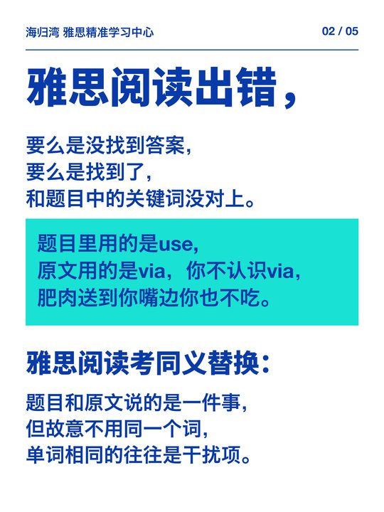</a>  <a href="assets/cards/ielts-reading-paraphrase/04.jpg">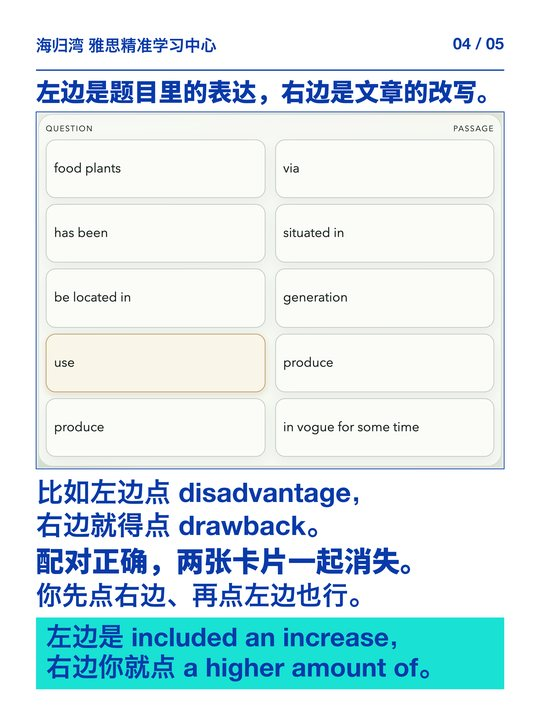</a> 

**[IELTS Sentence Repair · 雅思句子改错](https://ielts-repair.coze.site/)**

    

**[IELTS Writing · Band 6 to Band 8 · 雅思写作 6 分升 8 分](https://ielts6-8.coze.site/)**

    

## Cambridge English · 剑桥少儿英语

Picture flashcards for every word on the KET, PET and FCE lists.

<table>
<tr>
<td width="50%" valign="top"><a href="https://ket-flash.coze.site/">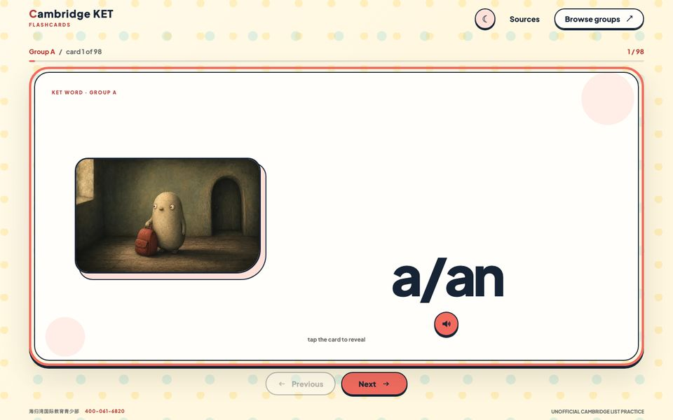</a>

**Cambridge KET Flashcards** · 剑桥 KET 词卡 Every word on the official A2 Key vocabulary list, each with a storybook picture and a British voice. 官方 A2 Key 词汇表全部单词，每张卡一幅绘本插画，配英式发音。

[**Open**](https://ket-flash.coze.site/) · [Global mirror](https://shelfom.github.io/cambridge-ket-flashcards/) · [Source](https://github.com/shelfom/cambridge-ket-flashcards)
</td>
<td width="50%" valign="top"><a href="https://pet-flash.coze.site/">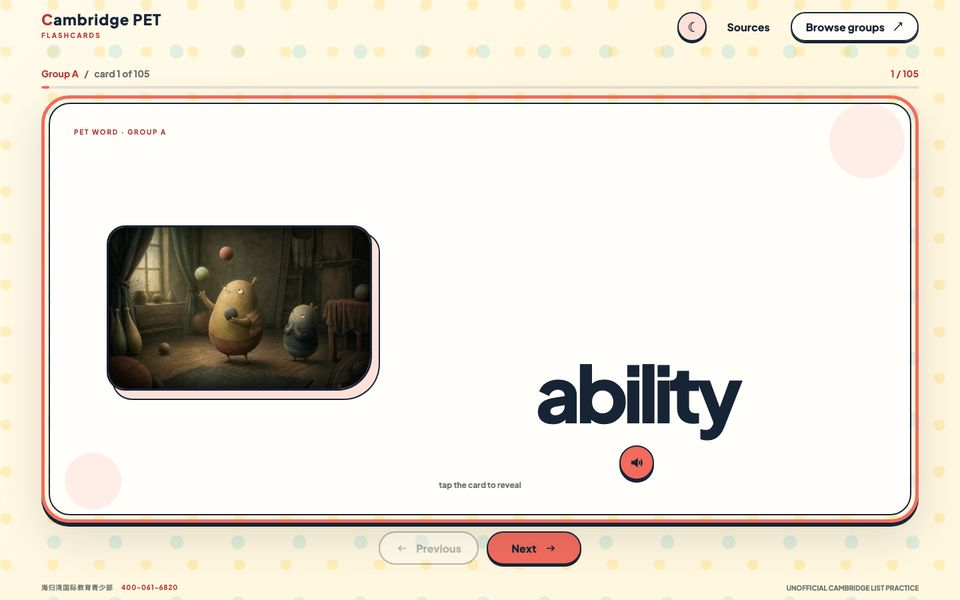</a>

**Cambridge PET Flashcards** · 剑桥 PET 词卡 The B1 Preliminary words that KET doesn't cover, each with a picture, a voice and a simple example. B1 Preliminary 词汇表里 KET 没有的全部单词，图、音、例句齐全。

[**Open**](https://pet-flash.coze.site/) · [Global mirror](https://shelfom.github.io/cambridge-pet-flashcards/) · [Source](https://github.com/shelfom/cambridge-pet-flashcards)
</td>
</tr>
<tr>
<td width="50%" valign="top"><a href="https://fce-flash.coze.site/">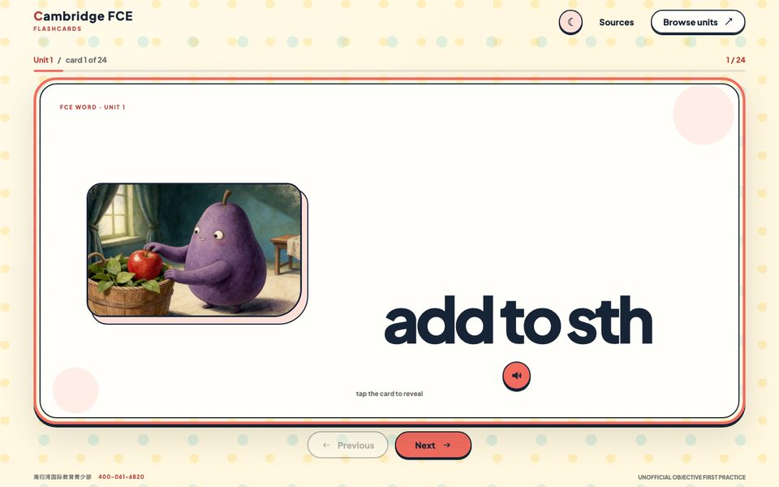</a>

**Cambridge FCE Flashcards** · 剑桥 FCE 词卡 The B2 First words beyond KET and PET, unit by unit, with pictures and a British voice. B2 First 中超出 KET、PET 的单词，按单元学习，图文配英式发音。

[**Open**](https://fce-flash.coze.site/) · [Global mirror](https://shelfom.github.io/cambridge-fce-flashcards/) · [Source](https://github.com/shelfom/cambridge-fce-flashcards)
</td>
<td width="50%"></td>
</tr>
</table>

## Vocabulary · 学术词汇

The Academic Word List for IELTS, TOEFL and university study.

<table>
<tr>
<td width="50%" valign="top"><a href="https://awl-flash.coze.site/">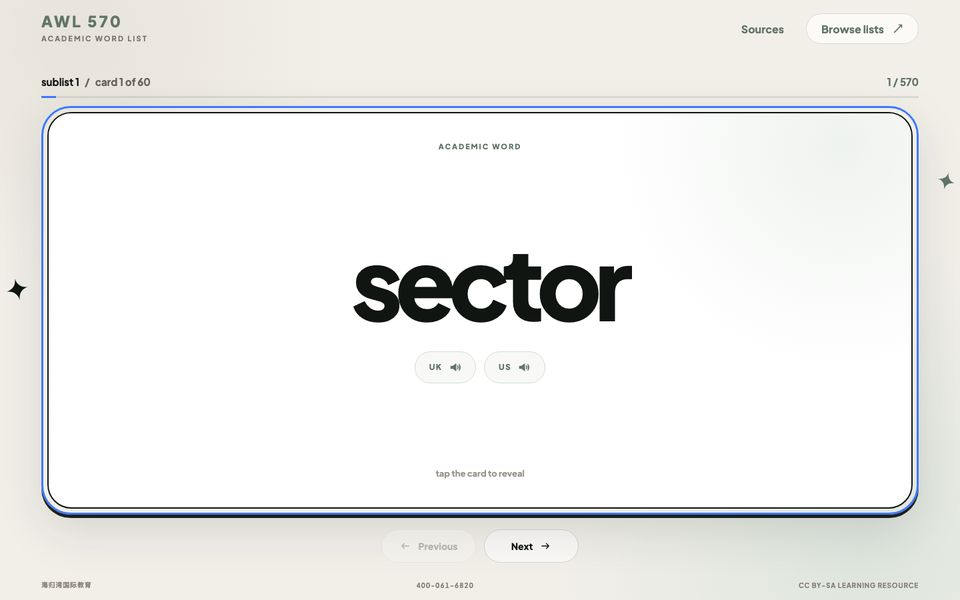</a>

**AWL 570 Flashcards** · 学术词汇表 570 词卡 All 570 headwords of the Academic Word List — the vocabulary of IELTS, TOEFL and university reading. 学术词汇表全部 570 个词族，雅思、托福和大学阅读的核心词汇。

[**Open**](https://awl-flash.coze.site/) · [Global mirror](https://shelfom.github.io/awl-570-flashcards/) · [Source](https://github.com/shelfom/awl-570-flashcards)
</td>
<td width="50%"></td>
</tr>
</table>

## For teachers and developers

- Use any site in class or as homework. Students need only the link.
- Each site lives in its own repository, so you can fork one and adapt it to your own students and word lists.
- **[IELTS Writing Task 2 Corrector](https://github.com/shelfom/TB-IELTS-Writer)** (雅思大作文批改): Brainstorm an outline and get band-descriptor feedback on a Task 2 essay. Self-host with your own API key.
- Mirror maintainers: `tools/publish-mirrors.sh` rebuilds every GitHub Pages mirror from the latest `main` branches.

Found a mistake or have an idea? [Open an issue](https://github.com/shelfom/free-english-learning-tools/issues). If these tools help you, please ⭐ **star this repo** so other learners can find them.

## Credits and license

Made by **Turtle Bay International Education (海归湾国际教育)**, an IELTS, TOEFL and Cambridge English school in Tianjin, China.

- Code: [MIT](LICENSE).
- Original learning content (illustrations, recordings, explanations, example sentences, model answers): free for non-commercial teaching and learning under [CC BY-NC 4.0](https://creativecommons.org/licenses/by-nc/4.0/).
- Third-party word lists and excerpts belong to their owners and are credited in each repository.
- Unofficial practice material, not affiliated with or endorsed by Cambridge University Press & Assessment, the British Council or IDP. IELTS is their registered trademark.
